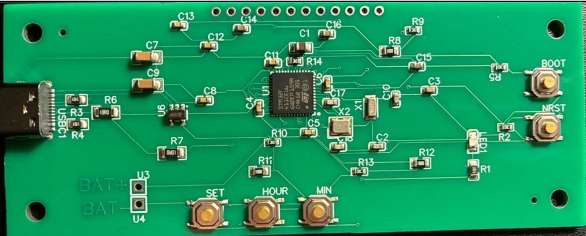
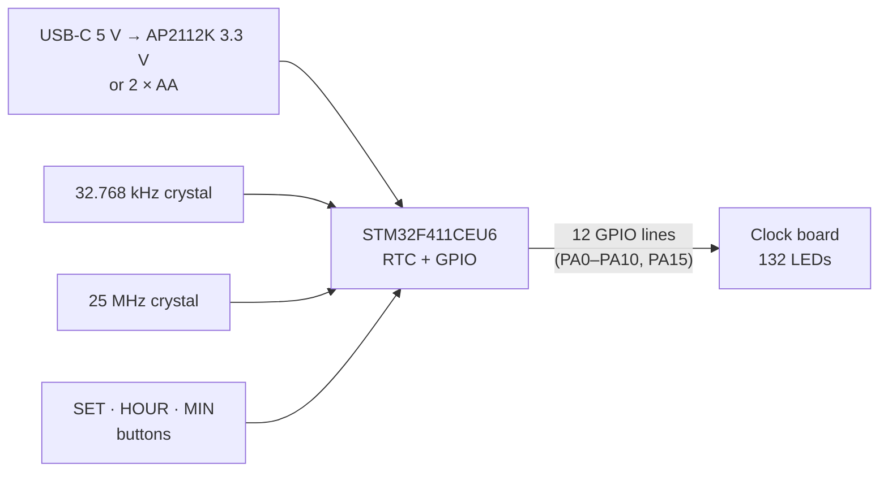
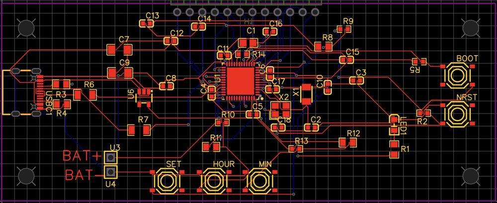

# Charlieplexed LED Clock (STM32)

An analog-style clock with **132 LEDs** (60 for seconds, 60 for minutes, 12 for hours) driven from just **12 pins** of an **STM32F411** using **charlieplexing**. The chip's built-in real-time clock keeps the time from a 32.768 kHz crystal, and three buttons set it. I designed the control board myself, a surface-mount PCB with USB-C. It plugs into the 132-LED clock board through a 12-pin header.

▶️ **[Demo video](https://youtu.be/WRYvI1c9H8k)**



*The assembled V2 control board.*

Built for my Grade 12 computer engineering course at Royal St. George's College (2025).

---

## Highlights

- **132 LEDs from 12 pins.** With charlieplexing, *n* pins can drive *n*(*n* − 1) LEDs, and 12 × 11 = 132: exactly one LED for every second, minute and hour position.
- **Persistence of vision:** only one LED in each ring is on at a time, scanned about 167 times a second, so all three hands look lit together.
- **Accurate timekeeping** from the STM32's RTC and a 32.768 kHz crystal.
- **Interrupt-driven time setting:** the SET button uses an external interrupt, and holding MIN auto-repeats.
- **Custom surface-mount PCB** designed in EasyEDA: STM32F411CEU6, USB-C, a 3.3 V LDO, two crystals, and decoupling at every power pin. V1 didn't work; the [V2](#pcb-design) fixed it.
- **A hand-made LED map.** The clock board's schematic turned out to be wrong, so I worked out the pin pair for all 132 LEDs myself (see [The LED map](#the-led-map)).

---

## How it works



### Charlieplexing

Every pair of pins has two LEDs between it, one facing each way. To light exactly one LED, the code:

1. sets **all 12 pins to inputs**, which makes them high-impedance, so they act as if disconnected;
2. makes the LED's two pins outputs, with the **anode pin HIGH** and the **cathode pin LOW**.

Current can only flow through the one LED that points from the HIGH pin to the LOW pin. Every other LED is connected to at least one floating pin, so it stays dark.

```c
void Set(int pos, int neg) {
    GPIO_InitStruct.Pin  = pos | neg;                  // only these two pins become outputs
    GPIO_InitStruct.Mode = GPIO_MODE_OUTPUT_PP;
    HAL_GPIO_Init(GPIOA, &GPIO_InitStruct);
    HAL_GPIO_WritePin(GPIOA, pos, GPIO_PIN_SET);       // anode HIGH
    HAL_GPIO_WritePin(GPIOA, neg, GPIO_PIN_RESET);     // cathode LOW
}
```

### Showing the time

A charlieplexed display can only light one LED at a time, so `DisplayTime()` takes turns:

```
second LED (2 ms) → minute LED (2 ms) → hour LED (2 ms) → repeat
```

One full pass takes 6 ms, so each hand is refreshed about **167 times per second**. That's far too fast to see flicker.

The `CLOCK[]` table holds the anode and cathode pin for every LED:

| `CLOCK[]` index | Ring | Lookup |
|---|---|---|
| 0 – 59 | Seconds | `CLOCK[sec]` |
| 60 – 119 | Minutes | `CLOCK[60 + min]` |
| 120 – 131 | Hours | `CLOCK[120 + hour % 12]` |

### Keeping time

The STM32F411 has a built-in **real-time clock (RTC)** running from an external **32.768 kHz** crystal. 32,768 is 2¹⁵, so dividing it by two 15 times gives exactly 1 Hz, one tick per second. The main loop reads the time with `HAL_RTC_GetTime()` and redraws the LEDs.

### Setting the time

| Button | Pin | What it does |
|---|---|---|
| **SET** | PB12 (external interrupt) | Switches between showing the time and set mode. Leaving set mode writes the new time into the RTC. |
| **HOUR** | PB13 | +1 hour (wraps after 23) |
| **MIN** | PB14 | +1 minute. Hold it for half a second and it auto-repeats every 100 ms. |

Set mode shows the time being edited, so you can watch the hands move while you set it. The buttons are detected on the falling edge (pressed = LOW), so a single press only counts once.

---

## The LED map

When I first ran my code, random LEDs lit up instead of the ones I expected. The schematic for the clock board turned out to be wrong. Instead of guessing, I spent about two and a half days testing every pin pair by hand, touching a positive and a negative wire to each of the 12 pins and writing down which LED lit. That map became the `CLOCK[]` table in [`main.c`](src/main.c), and I shared it with my classmates, who were stuck on the same problem.

Clock board pins (`P1`–`P12` in the code comments) map to STM32 port A like this:

| P1 | P2 | P3 | P4 | P5 | P6 | P7 | P8 | P9 | P10 | P11 | P12 |
|---|---|---|---|---|---|---|---|---|---|---|---|
| PA10 | PA8 | PA9 | PA15 | PA7 | PA4 | PA5 | PA6 | PA3 | PA2 | PA1 | PA0 |

---

## PCB design



*The V2 control board in EasyEDA.*

- **MCU in the middle, next to the 12-pin header,** which keeps the 12 charlieplexing traces short.
- **Crystals and decoupling capacitors right beside the MCU** for clean power and accurate timing.
- **USB-C with matched-length D+ / D− traces**, so the high-speed data signals arrive together.
- **AP2112K-3.3** regulator to turn USB's 5 V into a steady 3.3 V. Two AA batteries can also power the board.
- **BOOT and NRST buttons**, so the firmware can be updated over USB (DFU mode) without a programmer.

**V1 → V2:** the first board arrived three weeks early but my computer wouldn't recognise it over USB. It was missing the **25 MHz HSE crystal** the STM32 needs for USB. Because I'd started early, there was time to redesign, order and assemble V2 before the deadline.

### Parts (control board)

| Qty | Part |
|---|---|
| 1 | STM32F411CEU6 microcontroller |
| 1 | AP2112K-3.3TRG1 3.3 V regulator |
| 1 | USB-C female connector |
| 1 | 32.768 kHz crystal (RTC) + 2 × 4.3 pF |
| 1 | 25 MHz crystal (USB) + 2 × 12 pF |
| 8 | 100 nF decoupling capacitors |
| 3 / 1 / 1 | 10 µF / 2.2 µF / 1 µF capacitors |
| 9 / 3 / 3 / 2 | 10 kΩ / 5.1 kΩ / 100 Ω / 10 Ω resistors |
| 5 | Surface-mount push buttons (SET, HOUR, MIN, BOOT, NRST) |
| 1 | Surface-mount status LED |
| 1 | 2 × AA battery holder |

---

## Code

[`src/main.c`](src/main.c) contains the application: the LED map, charlieplexing, display scanning, button handling and the RTC interrupt. The hardware setup functions (`SystemClock_Config`, `MX_GPIO_Init`, `MX_RTC_Init`) are generated by **STM32CubeMX** and appear as stubs here.

**To build it:**
1. Create an STM32CubeIDE project for the **STM32F411CEU6**.
2. In CubeMX, enable the **LSE** crystal and the **RTC**, and the **HSE** at 25 MHz. Set PA0–PA10 and PA15 as GPIO, PB12 as an external interrupt on the falling edge (with the EXTI15_10 interrupt enabled), and PB13 / PB14 as inputs. Each button pin needs a pull-up.
3. Copy the user code from `src/main.c` into the generated `main.c`, then build and flash (over USB DFU with BOOT held, or with an ST-Link).

---

## What I learned

- **Start early.** It's what gave me time to recover from a PCB that didn't work and still finish a working V2.
- **Surface-mount PCB design:** placing an MCU with its crystals and decoupling, routing USB, and adding a regulator. Before this project I'd mostly stayed away from design.
- **Don't trust a schematic blindly.** When the hardware doesn't match the documentation, measuring it yourself is faster than guessing, and sharing what you find helps everyone.
- **Working on a professional MCU:** the STM32 HAL, GPIO modes, the RTC and external interrupts.
